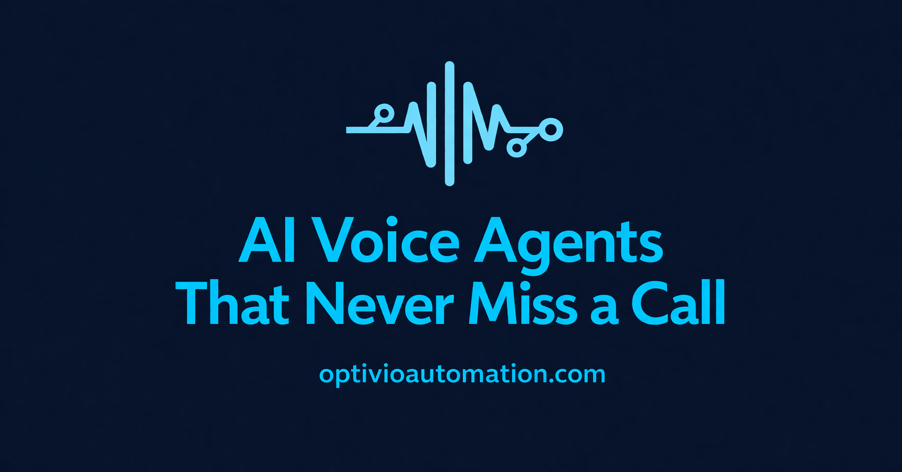

# Optivio Automation Site

Marketing website for **Optivio Automation**: AI voice agents that answer calls for service businesses, plus the legal and support pages for Optivio's Google Play apps.


[](LICENSE)

Live: https://optivioautomation.com · Apps: [Optivio Automation on Google Play](https://play.google.com/store/apps/developer?id=Optivio+Automation)



## Features

- **Landing page**: hero, problem, solution, how it works, pricing, social proof, FAQ and booking CTA, animated with Framer Motion.
- **SEO blog**: posts on missed-call cost, AI vs human receptionists and AI phone answering for service businesses, served from `lib/blog-data.ts` through a dynamic `blog/[slug]` route.
- **SEO plumbing**: per-page metadata, Open Graph image, generated `robots.txt` and `sitemap.xml`.
- **Legal pages**: privacy, terms and GDPR.
- **App support pages**: privacy policy and data-deletion pages for *Brick Breaker: Power Rush*, and `app-ads.txt` for AdMob verification.
- **Short links**: `/powerrush` and `/dareclock` redirect to the Play Store listings.
- **Security headers** and long-lived caching for static assets (`next.config.js`).

## Tech stack

Next.js 16 (App Router) · React 18 · TypeScript · Tailwind CSS 3 · Framer Motion · lucide-react · Vercel

## Repository layout

The Next.js app lives in the `optivio-automation/` subfolder. The root `vercel.json` points Vercel's install, build and output steps at that folder, so **do not move the app to the repo root** without also changing the Vercel project settings.

```
.
├── vercel.json              build/install/output pointed at optivio-automation/
├── images/                  brand logos (source files)
└── optivio-automation/      the Next.js app
    ├── app/                 routes: /, blog, games/<app>/{privacy,data-deletion}, gdpr, privacy, terms
    ├── components/          landing-page sections (Hero, Pricing, FAQ, ...)
    ├── lib/blog-data.ts     blog post content
    └── public/              logos, og-image.png, app-ads.txt
```

## Getting started

Prerequisites: Node.js 20+ and npm. No environment variables are required.

```bash
git clone https://github.com/realtahailyas/OptivioAutomation.git
cd OptivioAutomation/optivio-automation
npm install
npm run dev     # http://localhost:3000
npm run build   # production build
```

## Status

Live in production on Vercel. The site replaces the older static site at optiviomedia.online.

## License

[MIT](LICENSE) © 2026 Taha Ilyas

## Author

Built by [Taha Ilyas](https://github.com/realtahailyas) · Optivio Automation
